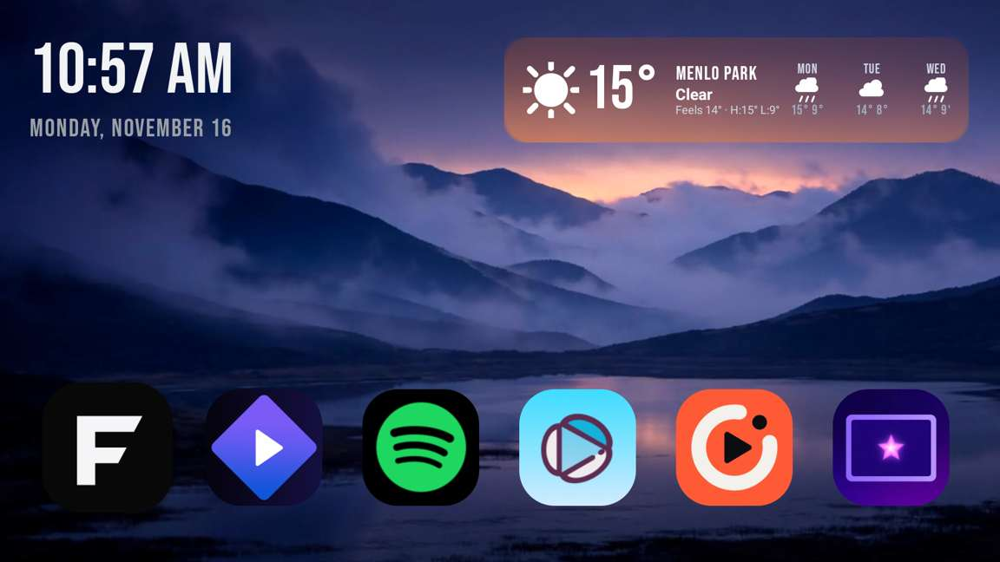
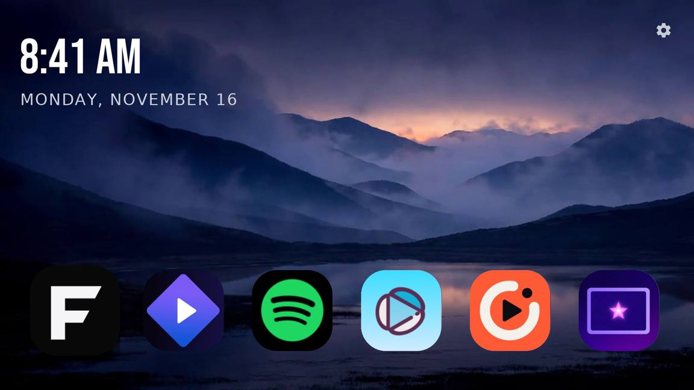

# OpenLaunchTV

A minimal Android TV home screen. One activity, zero dependencies, no ads, no recommendations, no network calls — just a clock, your apps, and a background that moves.



## Features

- **Live background** — a seamless looping video (a still photo shows while it loads, and on pause)
- **Icons-only dock** — your first apps pinned in a row; a chevron expands the full app grid below
- **Bebas Neue clock + date**, settings gear in the top-right corner (MENU key also opens Settings)
- **Long-press any tile:**
  - **Move** — reorder the dock
  - **Hide / Show on home screen** — keep the dock to what you actually use
  - **Change icon** — bundled alternate designs where provided, plus generated letter monograms
  - **Uninstall** — system apps open their App Info page instead
- Focus is the icon itself: it scales up with a soft shadow. No cards, no rails, no "sponsored" anything.



## Requirements

- Android TV / Google TV, API 28 (Android 9) or newer
- The launcher registers as a `HOME` / `LEANBACK_LAUNCHER` app. Your stock launcher stays installed — switching back is one settings change. Nothing is uninstalled or hidden; the grid is built from whatever apps are installed.

## Build

Two ways:

**Script (no Gradle):** needs a JDK 17 and the Android SDK (platform 34, build-tools 34.0.0) —

```sh
./build.sh   # produces openlaunch-tv.apk, debug-signed and sideloadable
```

`build.sh` runs the toolchain directly (aapt2 → javac → d8 → zipalign → apksigner) and honours `JAVA_HOME` / `ANDROID_SDK` if set.

**Android Studio:** open the project — the Gradle files are included and work normally there.

## Install

```sh
adb install -r openlaunch-tv.apk
```

Then press Home and pick OpenLaunchTV (or set it under Settings → Apps → Default apps → Home app).

## Branches

- **`stable`** — the vetted checkout. Only code that has been built and verified running on a real TV gets promoted here. Build from this one.
- **`latest`** — the newest work: verified builds that have not been promoted to main yet.

## License

MIT — see [LICENSE](LICENSE).

The bundled Bebas Neue font is © its respective authors and licensed under the SIL Open Font License 1.1.
